# Before the Divine Wind

> Create a cinematic, playable 3D samurai adventure using Three.js, set in 13th-century feudal Japan during a brutal Mongol invasion.
>
> You play as a young samurai who survives the massacre of his island's defenders while his uncle, the island's lord, is captured by the invading army. Realising traditional samurai combat cannot defeat the invaders, you gradually abandon honourable fighting and embrace stealth, deception and fear to liberate your homeland.
>
> Create a short but compelling experience with sword combat, enemy encounters, exploration and cinematic story moments. The emotional heart is the conflict between honour and survival, and the painful relationship between the samurai and the uncle who raised him.
>
> Focus on breathtaking Japanese landscapes, cherry blossoms, bamboo forests, burning villages, misty mountains, atmospheric lighting, dramatic weather and cinematic camera work.
>
> Make it feel like a premium cinematic samurai game, not a generic browser demo. Prioritise visual quality, atmosphere, satisfying gameplay and a memorable beginning-to-end experience.

One-shotted from this prompt with **Fable 5.2 (high)**. The Japanese voices were then generated with **Deepgram**. Open source.

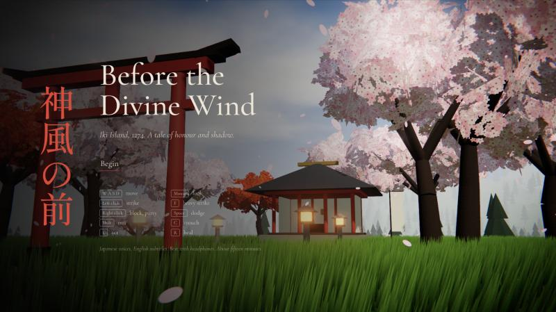

## Screenshots

| | |
| --- | --- |
| 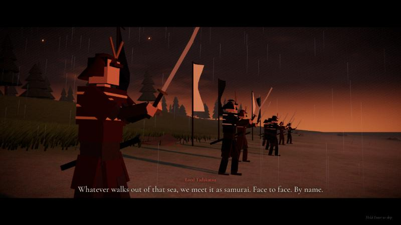 | 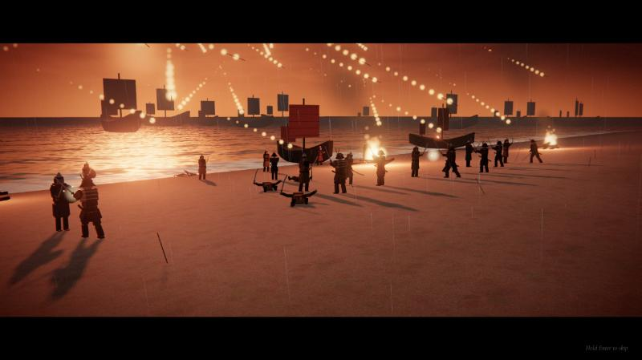 |
| 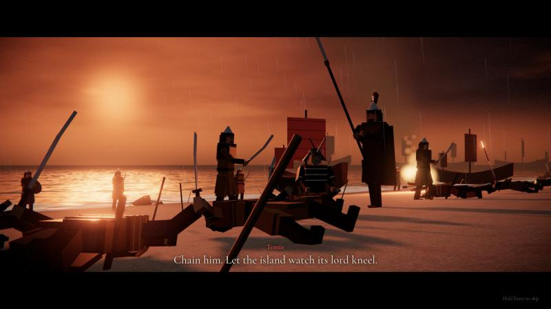 | 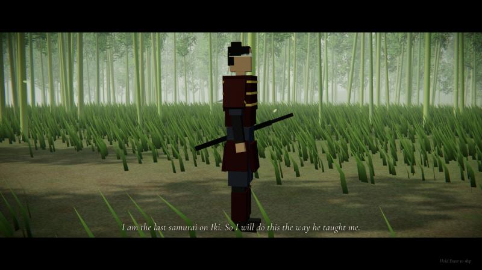 |
| 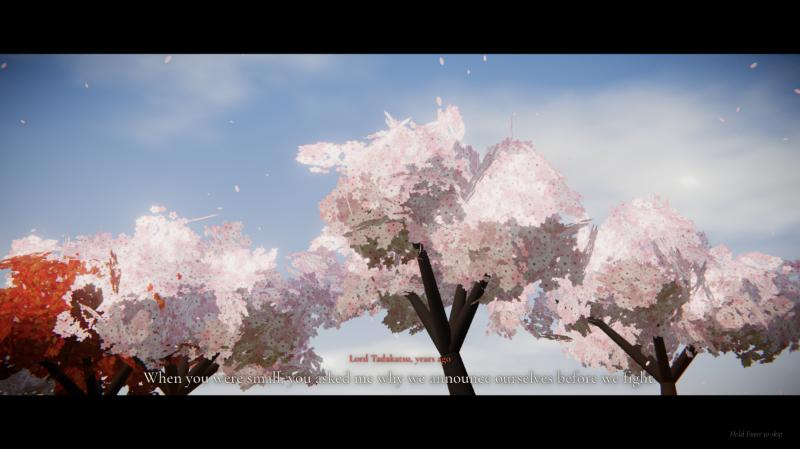 | 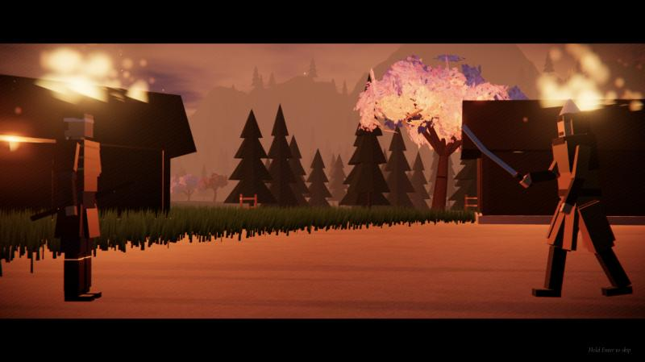 |
| 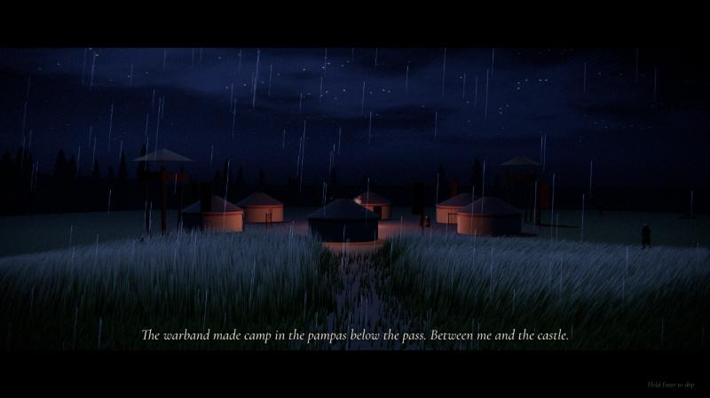 | 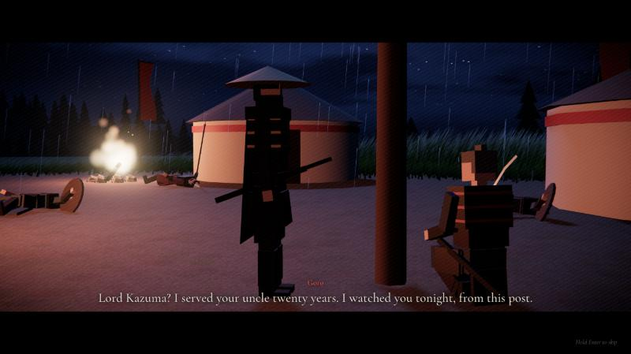 |
| 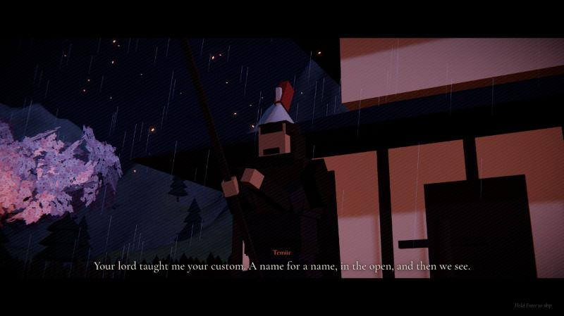 | 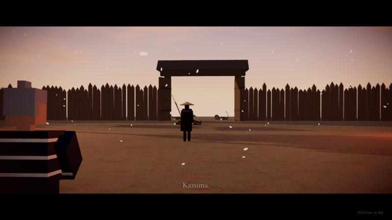 |

## Install

You need Python 3 and a modern desktop browser. There is no build step.

1. Clone the repository.

   ```bash
   git clone https://github.com/rezaulhreza/before-the-divine-wind.git
   ```

2. Go into the folder.

   ```bash
   cd before-the-divine-wind
   ```

3. Start the server.

   ```bash
   python3 serve.py 5173
   ```

4. Open http://localhost:5173 and click **Begin**.

## How to play

The game has Japanese voices and English subtitles. Use headphones if you can.

| Key | Action |
| --- | --- |
| W A S D | Move |
| Mouse | Look |
| Left click | Strike. Click again to chain cuts |
| F | Heavy strike. Breaks a raised shield |
| Right click | Block. Block at the last instant to parry |
| Space | Dodge. Use it for red attacks, which you cannot block |
| Shift | Run |
| C | Crouch. Tall grass hides you |
| E | Act, or strike from the shadow |
| R | Spend resolve to heal |
| Enter (hold) | Skip a cinematic |
| Esc | Pause |

- A white flash on a weapon means a strike you can parry. A red flash means dodge.
- Resolve fills as you fight. Spend it to heal.
- Later in the story, come from behind unseen. What your enemies cannot see, they learn to fear.

## Voices

The voice lines are in `audio/vo/`. To change a line, edit `tools/make_voices.py` and run it with your own Deepgram key. The script needs `ffmpeg`.

```bash
DEEPGRAM_API_KEY=your_key python3 tools/make_voices.py
```

## Licence

MIT. See [LICENSE](LICENSE). Three.js is included in `vendor/` under its own MIT licence.
